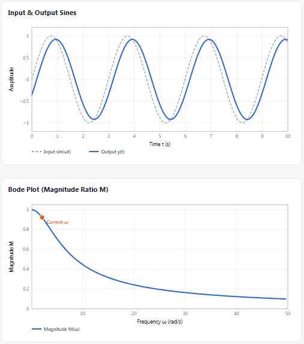

# encs4380-dynamics--Chinatown-
# ENCS4380 Homework 1: Dynamic Characteristics Toolkit

**Live site:** https://shahdfarraj.github.io/encs4380-dynamics--Chinatown-/

## What is this?
A web page that shows how a sensor responds over time and frequency. It runs in the browser only.
It needs no server and no internet connection.

## Who built what

| Member | Module |
|---|---|
| Leen Zuhud | Module 1: First-order time response |
| Shahd Farraj | Module 2: First-order frequency response |

## Module 1: First-order time response
A thermometer is slow. It takes time to reach the real temperature.
The page shows this with a graph.

You can:
- Change the sensor gain K, the time constant tau, and the input size A.
- Switch between a step input and a ramp input.
- See the 63.2 % point at tau and the 95 % point at 3 tau.
- See how late the sensor is on a ramp (the lag equals tau).
- See the log graph, where the line has slope -1/tau.
- Answer a "Predict, then check" question before moving the sliders.

### Validation check 1
The slides say the step response reaches 63.2 % of its final value at t = tau,
and 95 % at t = 3 tau. The page checks this itself and shows PASS or FAIL.

Result: PASS

## Module 2: First-order frequency response
A first-order sensor dampens high-frequency inputs and introduces a phase lag. The page visualizes how the sensor responds to dynamic sine-wave inputs using the formulas:
$$M = \frac{1}{\sqrt{1 + (\omega\tau)^2}} \quad \vert \quad \phi = -\tan^{-1}(\omega\tau)$$

You can:
- Change the time constant tau ($\tau$) and input frequency $\omega$.
- View input and output sines on the same plot to visually inspect phase lag and attenuation.
- See the live Bode plot showing amplitude ratio $M$ across a log scale of frequencies.
- Identify the cutoff frequency at $\omega = 1/\tau$.
- Compute dynamic error $\delta = M - 1$ live.

### Validation check 2
The slides specify that for $\tau = 0.2\text{ s}$ and input $\sin(2t)$, the output amplitude is 0.93 of the input with a phase lag of $21.8^\circ$. The page checks this automatically and displays PASS or FAIL.

Result: PASS

## Screenshots
**step response**

**ramp response**

**log graph**

**frequency response & Bode plot**

## Use of AI tools
We used Claude and ChatGPT to help write the code.
We tested it and can explain every line.
Related issues: #1, #2
